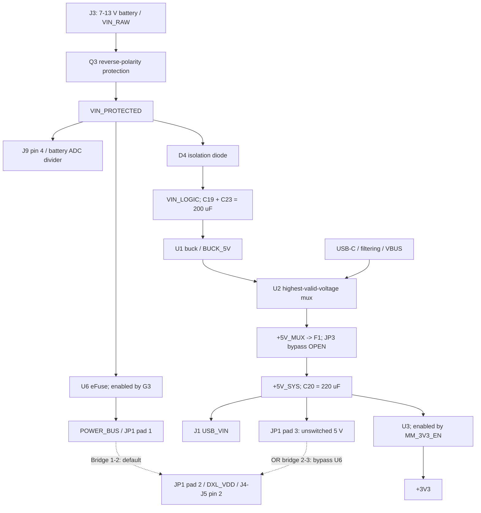

# MicroMod Carrier Board Reference

Updated against the current schematic netlist and saved PCB on **2026-09-21**.
This replaces the older V1.1 pinout and power-control description; it is not a
statement that PCB routing or fabrication checks are complete.

This is the firmware-facing hardware contract for the MicroMod Carrier. It
documents every carrier-connected MicroMod function and every exposed board
interface. Pin names describe the MicroMod standard signal; firmware must map
them to the GPIO names used by the installed MicroMod processor board.

The KiCad schematics are authoritative if this file and the hardware ever
disagree. In particular, confirm that the selected processor board implements
every MicroMod function used by the intended firmware.

## Current Reference Designators

| Reference | Current part / role |
| --- | --- |
| J1 / H1 | TE `2199230-4` MicroMod socket / separate M2.5 SMT standoff |
| J3 / Q3 / ZD1 | 7-13 V battery input / `30P03D` reverse-polarity MOSFET / 12 V gate clamp |
| D4 / C19 / C23 | `SS34` isolation diode / two 100 uF, 35 V `VIN_LOGIC` reservoir capacitors |
| U1 | `MPM3610GQV-Z` 5 V buck regulator |
| U2 | `TPS2116DRLR` power mux, highest-valid-voltage mode |
| F1 / JP3 | `BSMD1206-150-16V` resettable fuse / normally-open, PCB-only fuse bypass |
| U3 / ZD2 | `TLV75733PDBVR` 3.3 V regulator / 3.3 V `MM_3V3_EN` clamp |
| U4 / U5 | `74LVC1G126` DYNAMIXEL transmitter / `74LVC1G125` receiver |
| U6 / JP1 | `TPS259461A` servo-power eFuse / servo supply selector |
| J4 / J5 | Parallel vertical Molex `22-03-5035` DYNAMIXEL connectors |
| J6 | Hirose `FH12-18S-0.5SH(55)` EYESPI FPC connector |
| J7 / J8 | Vertical, top-entry JST `BM04B-SRSS-TB(LF)(SN)` Qwiic / UART connectors |
| J9 | 1x12, 2.54 mm power and expansion header |

`U6`, not the former discrete high-side switch, controls battery-fed servo
power. The old `JP2` regulator measurement link and `TP1`-`TP13` test-point
instances are absent from the current design. `JP3` bypasses **F1**, not U6,
and must remain open to retain the resettable fuse protection.

## Electrical Rules

- All logic signals on J7, J8, J9, J6, and the NeoPixel data input use a 3.3 V
  domain. Do not apply 5 V to any of these signals.
- The battery input is **7-13 V**. `VIN_PROTECTED` and J9 pin 4 can reach 13 V;
  they are not logic-level signals.
- `+5V_SYS` is the fused, muxed system rail. The resettable fuse is rated for
  **1.5 A hold / 3 A trip**, not a guaranteed current budget for servos. The
  source, buck regulator, USB power allowance, connectors, and temperature
  impose additional limits.
- DYNAMIXEL power can be a switched protected battery rail or `+5V_SYS`,
  selected by solder jumper JP1. **G3 controls servo power only with JP1
  bridged 1-2.** The 2-3 bench selection bypasses U6 and is powered whenever
  `+5V_SYS` is present. Use only a voltage supported by the attached servo.
- `DXL_TTL` is the buffered, nominal 5 V servo-side bus, not a direct 3.3 V
  GPIO connection. Use compatible TTL DYNAMIXEL devices, not RS-485 models
  or PWM hobby servos.
- MicroMod contact 4 is now connected to `MM_3V3_EN`: it can disable the
  carrier 3.3 V regulator. It is **not** the servo arm signal.
- RESET and BOOT are active-low pushbuttons to ground. They are not general
  GPIOs.
- The USB-C connector is a USB 2.0 device/sink port only. It is not a USB host
  or USB Power Delivery port.

## MicroMod Function Map

The table lists every functional MicroMod contact connected by the carrier.
Unlisted contacts are not application I/O on this board (they are unused,
reserved, or ground contacts defined by the MicroMod standard).

| Contact | MicroMod function | Carrier connection | Firmware use / constraint |
| ---: | --- | --- | --- |
| 2, 74 | 3.3 V | `+3V3` processor supply | Supply input; not a GPIO |
| 3 | USB D+ | USB-C J2 through ESD and a 0-ohm link | USB device data |
| 4 | 3.3V_EN | `MM_3V3_EN` to U3 EN | Default enabled by R5 with ZD2 clamp; do not pull low during normal operation |
| 5 | USB D- | USB-C J2 through ESD and a 0-ohm link | USB device data |
| 6 | RESET | RESET pushbutton | Active low; do not use as GPIO |
| 9 | USB_VIN | `+5V_SYS` | Board is powered from muxed battery/USB 5 V |
| 10 | D0 | EYESPI D/C | Display data/command control |
| 11 | BOOT | BOOT pushbutton | Active low; processor-specific boot function |
| 12 | I2C SDA | J7 and EYESPI J6 | Shared I2C bus, 3.3 V |
| 14 | I2C SCL | J7 and EYESPI J6 | Shared I2C bus, 3.3 V |
| 16 | I2C_INT | EYESPI J6 pin 4 | Capacitive-touch interrupt when fitted |
| 17 | UART1 TX | J8 pin 4 | 3.3 V UART output, named from processor perspective |
| 18 | D1 / CAM_TRIG | EYESPI reset | Display reset control |
| 19 | UART1 RX | J8 pin 3 | 3.3 V UART input, named from processor perspective |
| 20 | UART2 RX | DYNAMIXEL half-duplex receiver | Receive side of the TTL bus |
| 21 | SWD clock | `SWDCK` | Debug label only; no application peripheral attached |
| 22 | UART2 TX | DYNAMIXEL half-duplex transmitter | Transmit side of the TTL bus |
| 23 | SWD data | `SWDIO` | Debug label only; processor-dependent availability |
| 32 | PWM0 | EYESPI `LITE` | Display backlight PWM through 22 ohms |
| 34 | A0 | `BAT_SENSE` | Reserved battery-voltage measurement input |
| 38 | A1 | J9 pin 12 (`EXP_A1`) | Expansion analog/GPIO, 3.3 V maximum |
| 40 | G0 | EYESPI SD chip select | Dedicated to EYESPI while J6 is in use |
| 41 | CAN RX | J9 pin 5 | CAN-capable GPIO input; no CAN transceiver is fitted |
| 42 | G1 | EYESPI touch chip select | Dedicated to EYESPI while J6 is in use |
| 43 | CAN TX | J9 pin 6 | CAN-capable GPIO output; no CAN transceiver is fitted |
| 44 | G2 | `DXL_TXEN_MCU` through R10 to `DXL_TXEN` | High: transmit. Low: receive/default state |
| 46 | G3 | `DXL_PWR_SW` through R8 to U6 `DXL_EFUSE_EN` | High enables `POWER_BUS`; low disables it; JP1 2-3 bypasses this control |
| 47 | PWM1 | Onboard NeoPixel data | PWM/GPIO output through 33 ohms |
| 48 | G4 / BUS4 | EYESPI memory chip select | Dedicated to EYESPI while J6 is in use |
| 55 | SPI CS | EYESPI display chip select | Dedicated display CS |
| 57 | SPI SCK | EYESPI J6 pin 15 | Shared display/SD/memory/touch SPI clock |
| 59 | SPI SDO | EYESPI J6 pin 14 | SPI MOSI/COPI from the processor |
| 61 | SPI SDI | EYESPI J6 pin 13 | SPI MISO/CIPO into the processor |
| 66 | SDIO_DATA1 | J9 pin 11 (`EXP_G9`) | Carrier expansion alias; not standard MicroMod G9/contact 65 |
| 67 | G8 | J9 pin 7 | Expansion GPIO, 3.3 V |
| 69 | G7 / BUS7 | J9 pin 8 | Expansion GPIO/bus signal, 3.3 V |
| 70 | SPI_CS1# / SDIO_DATA3 | J9 pin 10 (`EXP_G10`) | Carrier expansion alias; not standard MicroMod G10/contact 63 |
| 71 | G6 / BUS6 | J9 pin 9 | Expansion GPIO/bus signal, 3.3 V |
| 73 | G5 / BUS5 | EYESPI BUSY | Display busy input |

Contact 49 (`BATT_VIN`) is intentionally not connected. The carrier battery
rail can reach 13 V and must not be assumed safe for a universal processor
module input. Standard G9/G10 contacts 65/63 and SDIO_DATA2 contact 68 are also
unconnected on this carrier; do not infer their wiring from the `EXP_G9` and
`EXP_G10` net names.

## Arduino Pin Map by Processor Board

Use the numbers below with Arduino functions such as `pinMode()`,
`digitalWrite()`, and `analogRead()`. The names in parentheses are standard
Arduino bus objects or aliases where applicable. `NC` means that the processor
board does not connect that MicroMod contact; software pin routing cannot make
the carrier signal available.

| Contact | Carrier / MicroMod signal | MicroMod Teensy Arduino | MicroMod ESP32 Arduino |
| ---: | --- | --- | --- |
| 4 | Carrier 3.3 V enable | pin 28; supply control, not general I/O | NC |
| 10 | EYESPI D/C / D0 | pin 4 | GPIO14 |
| 12 | I2C SDA | pin 18 (`SDA`, `Wire`) | GPIO21 (`SDA`, `Wire`) |
| 14 | I2C SCL | pin 19 (`SCL`, `Wire`) | GPIO22 (`SCL`, `Wire`) |
| 16 | EYESPI interrupt / I2C_INT | pin 29 | GPIO4 |
| 17 | J8 UART1 TX | pin 1 (`Serial1` TX) | GPIO17 (`Serial1` TX) |
| 18 | EYESPI reset / D1 | pin 5 | GPIO27 |
| 19 | J8 UART1 RX | pin 0 (`Serial1` RX) | GPIO16 (`Serial1` RX) |
| 20 | DYNAMIXEL UART2 RX | pin 16 (`Serial2` RX) | NC |
| 22 | DYNAMIXEL UART2 TX | pin 17 (`Serial2` TX) | NC |
| 32 | EYESPI LITE / PWM0 | pin 3 | GPIO13 |
| 34 | BAT_SENSE / A0 | pin 14 (`A0`) | GPIO34, input only |
| 38 | J9 pin 12 / A1 | pin 15 (`A1`) | GPIO35, input only |
| 40 | EYESPI SD CS / G0 | pin 40 | GPIO15 |
| 41 | J9 CAN RX | pin 30 (`CAN1` RX) | NC |
| 42 | EYESPI touch CS / G1 | pin 41 | GPIO25 |
| 43 | J9 CAN TX | pin 31 (`CAN1` TX) | NC |
| 44 | DXL_TXEN / G2 | pin 42 | GPIO26 |
| 46 | DYNAMIXEL power enable / G3 | pin 43 | GPIO17; shared with J8 TX |
| 47 | NeoPixel / PWM1 | pin 2 | GPIO12 |
| 48 | EYESPI memory CS / G4 | pin 44 | GPIO16 |
| 55 | EYESPI display CS / SPI CS | pin 10 (`SS`) | GPIO5 (`SS`) |
| 57 | EYESPI SPI SCK | pin 13 (`SCK`, `SPI`) | GPIO18 (`SCK`, `SPI`) |
| 59 | EYESPI MOSI / SPI SDO | pin 11 (`MOSI`, `SPI`) | GPIO23 (`MOSI`, `SPI`) |
| 61 | EYESPI MISO / SPI SDI | pin 12 (`MISO`, `SPI`) | GPIO19 (`MISO`, `SPI`) |
| 66 | J9 pin 11 / EXP_G9 / SDIO_DATA1 | pin 34 | NC |
| 67 | J9 pin 7 / G8 | pin 26 (`A12`; digital I/O available) | NC |
| 69 | J9 pin 8 / G7 | pin 9 | NC |
| 70 | J9 pin 10 / EXP_G10 / SDIO_DATA3 | pin 39 (Teensy core 1.56 or later) | NC |
| 71 | J9 pin 9 / G6 | pin 6 | GPIO33 |
| 73 | EYESPI BUSY / G5 | pin 45 | GPIO32 |

Supply, USB, reset, and boot contacts are omitted; contact 4 is listed only
because treating it as an ordinary GPIO could turn off the carrier 3.3 V rail.
On Teensy, `LED_BUILTIN` is pin 13 and therefore
shares the EYESPI SPI clock. On ESP32, the processor-board status LED is GPIO2
and is separate from the carrier NeoPixel.

The Teensy mapping above uses the current core numbering: contact 66 is pin
**34**, and contact 70 is pin **39**, not G2/pin 42. Older Teensy cores used
different numbering for contacts 68/70; select **Teensy MicroMod** and use core
1.56 or newer. UART2 is `Serial2`: **RX 16, TX 17**.

### ESP32 Limitations

- The DYNAMIXEL interface is not usable as routed: UART2 RX/TX contacts 20 and
  22 are not connected on the MicroMod ESP32 Processor Board. G2 and G3 remain
  available, but they provide only direction and power control without data.
- J9 CAN RX/TX, G7, G8, and the new `EXP_G9`/`EXP_G10` contacts 66/70 are also
  unavailable on the original SparkFun ESP32 processor (WRL-16781). Its
  processor schematic leaves these connector contacts unconnected. The
  carrier's older note claiming contacts 66/70 work on that ESP32 board is
  stale; do not assign GPIO4/GPIO13 to them based on the ESP32 chip's SDIO
  capabilities alone.
- A0/GPIO34 and A1/GPIO35 are input-only. They have no internal pull-up or
  pull-down resistors.
- PWM1/GPIO12 and G0/GPIO15 are ESP32 boot-strapping pins. Forcing GPIO12 high
  at reset can select the wrong flash voltage and prevent boot. GPIO15 low
  suppresses boot messages; account for the fitted EYESPI pull-up.
- G3/GPIO17 and G4/GPIO16 share the pins used by `Serial1`. On this carrier,
  enabling DYNAMIXEL power with G3 conflicts with J8 UART1 transmission, and
  EYESPI memory CS on G4 conflicts with J8 UART1 reception.
- A UART TX line idles high: merely starting J8 UART1 can therefore enable
  U6 through the shared G3 pin. Keep servo power physically isolated during
  ESP32/J8 experiments; a firmware pin alias cannot remove this connection.

## Connectors and Exposed Pins

### J2: USB-C

| Pin group | Connection |
| --- | --- |
| VBUS | `VBUS`, one input to the highest-valid-voltage 5 V power mux |
| D+ / D- | MicroMod USB D+ / D- through ESD protection |
| CC1 / CC2 | 5.1 kohm pull-downs; requests default USB power as a sink/device |
| SBU | Not connected |

### J3: Battery Input

| Pin | Net | Meaning |
| ---: | --- | --- |
| 1 | `VIN_RAW` | Positive battery input, 7-13 V |
| 2 | GND | Battery return |

`VIN_RAW` passes through reverse-polarity protection before becoming
`VIN_PROTECTED`. Q3 provides this protection; D4 instead isolates the
`VIN_LOGIC` reservoir feeding the buck. U2 selects the **higher valid voltage**
between `BUCK_5V` and USB `VBUS`, not a fixed battery-priority input.

### J4 and J5: DYNAMIXEL TTL

J4 and J5 are electrically parallel three-pin vertical Molex `22-03-5035`
connectors. Use the KiCad pad numbers below, not an assumed cable viewing
direction or an older right-angle-connector drawing.

| Pin | Net | Meaning |
| ---: | --- | --- |
| 1 | `DXL_TTL` | Shared half-duplex TTL data |
| 2 | `DXL_VDD` | Selected servo supply |
| 3 | GND | Servo return |

JP1 selects the source for `DXL_VDD`:

| JP1 bridge | Source | G3 power control | Intended use |
| --- | --- | --- | --- |
| Pads 1-2 (fabricated default) | `VIN_PROTECTED` through U6 to `POWER_BUS` | Yes, high = on | Compatible battery-powered servos |
| Pads 2-3, after cutting 1-2 | `+5V_SYS` directly | **No; U6 is bypassed** | Only servos rated for 5 V, within the shared supply budget |

Never bridge both JP1 sides. That would connect `POWER_BUS` to `+5V_SYS` and
can feed battery voltage into the 5 V rail when U6 turns on. USB alone does not
power `VIN_PROTECTED` or the default 1-2 servo path. Setting G3 high with no
battery does not create a servo supply.

### J6: EYESPI 18-Pin FPC

J6 is a Hirose `FH12-18S-0.5SH(55)` EYESPI connector. Its PCB contact numbering
is reversed relative to the display-side EYESPI pinout for the specified
**opposite-side-contact (type A-B) FPC cable**: display contact 1 reaches J6
contact 18. The table is **carrier J6 numbering**, not display-side numbering.
All active-low display
chip-select and reset lines have connector-side 100 kohm pull-ups, so they
remain inactive while the processor is reset or absent.

| Pin | EYESPI signal | MicroMod function / notes |
| ---: | --- | --- |
| 1 | NC | Not connected |
| 2 | NC | Not connected |
| 3 | BUSY | G5, display busy input |
| 4 | INT | I2C_INT, touch interrupt |
| 5 | SDA | Shared I2C SDA |
| 6 | SCL | Shared I2C SCL |
| 7 | TSCS | G1, touch-controller chip select |
| 8 | MEMCS | G4, onboard-memory chip select |
| 9 | SDCS | G0, SD card chip select |
| 10 | DISPCS / TCS | Primary SPI CS, display chip select |
| 11 | RESET | D1, display reset |
| 12 | DC | D0, display data/command |
| 13 | MISO / CIPO | Primary SPI SDI, input to processor |
| 14 | MOSI / COPI | Primary SPI SDO, output from processor |
| 15 | SCK | Primary SPI clock |
| 16 | GND | Ground |
| 17 | LITE | PWM0 backlight control |
| 18 | 3V3 | `+3V3` supply |
| 19, 20 | GND | Mechanical mounting pads, not FPC contacts |

### J7: Qwiic / I2C

J7 is a vertical, top-entry JST-SH `BM04B-SRSS-TB(LF)(SN)` connector, LCSC
`C160390`. Pins 1-4 were electrically reversed from the earlier mirrored
revision; the following is the current schematic and PCB assignment.

| Pin | Net | Meaning |
| ---: | --- | --- |
| 1 | GND | Ground |
| 2 | `+3V3` | Logic supply |
| 3 | `I2C_SDA` | Shared I2C SDA |
| 4 | `I2C_SCL` | Shared I2C SCL |
| 5, 6 | GND | Mechanical mounting pads, not cable contacts |

The board provides 4.7 kohm I2C pull-ups. Optional companion pull-ups may be
removed when downstream devices already make the bus too strong.

### J8: 3.3 V UART1

J8 uses the same vertical `BM04B-SRSS-TB(LF)(SN)` connector and revised pin
order as J7. TX and RX names are from the carrier processor perspective;
connect J8 RX to the external device's TX and J8 TX to its RX.

| Pin | Net | Meaning |
| ---: | --- | --- |
| 1 | GND | Ground |
| 2 | `+3V3` | Logic supply |
| 3 | `UART_RX` | UART1 data into the processor |
| 4 | `UART_TX` | UART1 data from the processor |
| 5, 6 | GND | Mechanical mounting pads, not cable contacts |

The shared schematic symbol retains its legacy `SM04B-SRSS-TB` library name
and now draws pins left-to-right as **6, 4, 3, 2, 1, 5**. The footprint/MPN is
the vertical BM04B part. Always identify a connection by pin number, not its
left/right position in the schematic or a view of the PCB underside.

### J9: Expansion Header

J9 is a vertical **1x12**, 2.54 mm header. In particular, **A1 moved to pin 12**;
pin 10 is now `EXP_G10` and pin 11 is `EXP_G9`.

| Pin | Net | Meaning |
| ---: | --- | --- |
| 1 | GND | Common return |
| 2 | `+3V3` | Regulated logic rail |
| 3 | `+5V_SYS` | Fused, muxed 5 V rail |
| 4 | `VIN_PROTECTED` | Reverse-protected battery rail, 13 V maximum |
| 5 | `EXP_CAN_RX` | MicroMod CAN RX, contact 41 |
| 6 | `EXP_CAN_TX` | MicroMod CAN TX, contact 43 |
| 7 | `EXP_G8` | G8, contact 67 |
| 8 | `EXP_G7` | G7 / BUS7, contact 69 |
| 9 | `EXP_G6` | G6 / BUS6, contact 71 |
| 10 | `EXP_G10` | Contact 70, SPI_CS1# / SDIO_DATA3; Teensy pin 39 |
| 11 | `EXP_G9` | Contact 66, SDIO_DATA1; Teensy pin 34 |
| 12 | `EXP_A1` | A1, contact 38; Teensy pin 15 / ESP32 GPIO35 input-only |

J9 exposes CAN-capable processor pins only; it does not include a CAN
transceiver or a differential CAN bus connector.

The cached header symbol still has legacy function text `A1/GPIO_10` and
`G10/GPIO_12`. Those names are stale: the actual schematic nets and PCB pads
agree with the table above. Use net names and pin numbers for firmware.

## Onboard Controls and Indicators

| Item | Processor connection | Firmware notes |
| --- | --- | --- |
| SW1 RESET | RESET, contact 6 | Active-low reset pushbutton |
| SW2 BOOT | BOOT, contact 11 | Active-low bootloader pushbutton |
| D3 NeoPixel | PWM1, contact 47 | Data via 33 ohms; its 3.3 V supply is below the LED's 3.5 V specified minimum, so validate on hardware |
| U6 pin 4 / R45 | `DXL_FLT`, not connected to a processor GPIO | Active-low open-drain fault output, pulled up to +3V3 by 100 kohms |

There are no dedicated `TP1`-`TP13` footprints in the saved board. In
particular, do not write firmware assuming `DXL_FLT` is available at `TP13`
or a MicroMod GPIO. Probe a suitable pad on that net during bench testing;
automatic fault-input monitoring requires an additional physical connection.

## DYNAMIXEL Control and Arming

There are three separate controls:

1. **Bus direction** (`G2`) selects transmit versus receive. It is not a
  power switch or torque enable.
2. **Servo rail enable** (`G3`) turns U6 on/off, and controls `DXL_VDD` only
  with JP1 in the default 1-2 position.
3. **Servo torque enable** is a DYNAMIXEL protocol command to each servo.
  Supplying power is not the same as deliberately arming torque. There is
  no additional carrier `ARM` pin and these are not PWM-controlled servos.

### Firmware Signals (MicroMod Teensy)

| Purpose | MicroMod contact / net | Teensy Arduino interface |
| --- | --- | --- |
| Servo power enable | 46 / G3 / `DXL_PWR_SW` | `digitalWrite(43, HIGH)` enables U6; `LOW` disables it |
| Half-duplex direction | 44 / G2 / `DXL_TXEN_MCU` | Pin 42: high = transmit, low = receive |
| Servo serial TX | 22 / `DXL_TX` | `Serial2`, TX pin 17 |
| Servo serial RX | 20 / `DXL_RX` | `Serial2`, RX pin 16 |
| Battery measurement | 34 / `BAT_SENSE` | `analogRead(A0)`, pin 14 |
| eFuse fault | U6 pin 4 / `DXL_FLT` | No assigned GPIO in this design |

The GPIO numbers in this table are **Teensy Arduino numbers**, not connector
pad numbers. Do not substitute the ESP32 pin map: its UART2 connector
contacts are NC, and G3 is shared with J8 TX.

### Half-Duplex Transfers

The DYNAMIXEL interface uses UART2 plus a hardware-controlled half-duplex
buffer pair. U4 is powered by `+5V_SYS`; U5 is powered by `+3V3` and returns
3.3 V logic to the processor. R11 (10 kohms) pulls `DXL_TXEN` low; R16 pulls
the MCU RX input high when the receiver output is disabled.

| State | G2 / `DXL_TXEN` | UART2 behavior |
| --- | --- | --- |
| Idle / receive | Low | Transmitter disabled, receiver enabled |
| Transmit | High | Transmitter enabled, receiver disabled; send the frame, wait for its final stop bit, then return low |

Configure UART2 as 8N1 at the baud rate stored in the servos, with the
protocol version appropriate to their model. A DYNAMIXEL library should
own the direction GPIO; for example, a Teensy `Dynamixel2Arduino` setup uses
`Serial2` and direction pin **42**, not power-enable pin 43. If handling
direction manually, wait for actual hardware TX completion (on Teensy,
`Serial2.flush()`) before returning G2 low; an empty software queue alone
does not mean the final byte has left the wire. Release the bus promptly
enough to receive the servo's status packet.

### Servo Power and eFuse Defaults

| G3 state | U6 / `POWER_BUS` | `DXL_VDD` with JP1 1-2 | `DXL_VDD` with JP1 2-3 |
| --- | --- | --- | --- |
| Low / processor high-impedance | Disabled by R9 pull-down | Supply path off; stored charge may remain | Still powered from `+5V_SYS` |
| High | Enabled if input and protection conditions permit | Ramps toward `VIN_PROTECTED` | Still powered from `+5V_SYS`; G3 has no control |

G3 drives U6 EN/UVLO through R8 (1 kohm); R9 (47 kohms) holds it off while the
processor pin is undriven. U6 is `TPS259461A`, the **auto-retry** variant:
leaving G3 high does not latch a faulted servo rail safely off.

| Tuning part | Connection | Nominal design setting |
| --- | --- | --- |
| R44, 604 ohms, 1% | U6 ILM to GND | About 5.52 A forward current limit |
| C21, 10 nF | U6 dVdt to GND | About 0.2 V/ms output ramp |
| C22, 10 nF | U6 ITIMER to GND | About 8.4 ms overcurrent transient blanking; **not** servo boot time or retry period |
| R45, 100 kohms | +3V3 to `DXL_FLT` | Active-low open-drain fault indication |

These are nominal component-derived settings, not a validated continuous
current rating for the whole board. The transient blanking permits peaks
above the programmed current limit; it is not a precise 5.52 A clamp at all
times. U6 OVLO is grounded (no configured external overvoltage cutoff), and
SPLYGD is unconnected. `BAT_SENSE` measures the input rail, **not** U6 output,
servo current, or a power-good indication.

### Startup and Deliberate Arming

The sequence below assumes battery operation with **JP1 1-2**. In 5 V bench
mode, use an external power disconnect and verify the 5 V rail directly;
G3 cannot isolate the servos and A0 does not measure their selected supply.
The protocol/torque checks still apply.

1. **Before applying servo power:** verify JP1, supply polarity/voltage,
  connector pinout, current budget, and mechanically support the load.
  Confirm the servo model's startup-torque settings; do not assume a reboot
  always leaves every model torque-disabled.
2. Preload the G3/pin-43 and G2/pin-42 output values **low**, then configure
  them as outputs early in startup. Keep G3 low until an explicit arm
  request. Keep `MM_3V3_EN` enabled; it is not a servo-power control.
3. Initialize `Serial2` / the DYNAMIXEL library with the intended baud rate,
  protocol version, and direction pin 42. Keep the bus in receive while
  idle. Do not use the Arduino `Servo` PWM library for this interface.
4. On an explicit arm request, validate battery voltage through A0 and all
  application interlocks. With JP1 1-2, drive **pin 43 high**. Allow the
  eFuse ramp and the servo's documented boot time before expecting replies.
  The nominal ramp alone is about 35-65 ms over 7-13 V; use a bounded
  readiness/ping sequence rather than treating that estimate as a universal
  boot delay.
5. Ping the intended servo IDs and require valid replies. Read model/status
  and hardware-error information. Explicitly command **torque off** before
  configuring operating mode, limits, or profiles that require it. Use
  model-specific register definitions, not a universal register address.
6. Establish a safe initial goal for the selected mode, typically a hold
  target based on the measured position for position control. Account for
  the model's position-reset behavior on mode changes and torque enable.
  Configure conservative velocity/acceleration/current limits as supported.
7. Only after successful checks, issue the per-servo **Torque Enable**
  command (for example `torqueOn(id)` in Dynamixel2Arduino) and verify the
  resulting state. Then send goals and monitor feedback/timeouts. This is
  the application torque-armed state; G3 remains high and G2 is high only
  for outgoing packets.

If startup communication or validation fails, do not enable torque. Return
G2 low, request G3 low for the switched supply path, and require a new
deliberate arm attempt. Do not silently re-arm after a reset or fault.

### Normal Disarm, Faults, and Regeneration

For normal shutdown, command a controlled stop and wait for the mechanism to
settle while U6 is still enabled. Send **Torque Disable** (`torqueOff(id)`),
confirm it where possible, complete the serial transfer, return G2 low, then
drive G3 low. With JP1 2-3, this last step **does not remove servo power**;
physical supply isolation is needed. Torque removal can let a loaded joint
fall, and output capacitors can retain voltage after the power path is off.

When enabled, U6 allows regenerative current back toward `VIN_PROTECTED`
and the battery; its forward current limit does not regulate that reverse
current. During normal braking, retain the return path and use a battery/BMS
that can accept the charge. A bench supply may not sink energy. Disconnecting
the supply or disabling U6 during regeneration can overvoltage the servo
rail; the design does not provide a configured OVLO cutoff or braking dump
load to make arbitrary power removal safe.

On a detected fault or communication timeout, follow the application's
validated stop policy, remove the arm request, and prevent uncontrolled
auto-retry/re-arming. There is no dedicated hardware emergency-stop input
or firmware-readable eFuse fault GPIO in this revision. G3 control and
protocol torque disable are not substitutes for a system-level safety stop.

During bench validation, verify the fitted U4 buffer's input-high margin
with 3.3 V MCU TX/OE drive and its 5 V supply, as well as UART timing and
eFuse thermal behavior, before testing full servo loads.

## Battery Measurement

MicroMod A0 receives `BAT_SENSE` through a 100 kohm / 27 kohm divider from
`VIN_PROTECTED`, filtered with 100 nF. Use the processor board's ADC reference
and calibration, then recover the protected rail as:

$$
V_{VIN\_PROTECTED} = V_{ADC} \times \frac{127}{27} \approx V_{ADC} \times 4.7037
$$

This measures the protected rail after the reverse-polarity MOSFET. The actual
battery terminal voltage is slightly higher under load by the MOSFET's voltage
drop. At the 13 V input limit, `BAT_SENSE` is nominally 2.764 V.

## Resource Conflicts and Initialization

- I2C SDA/SCL are shared by J7 and EYESPI. A display with capacitive touch may
  also use `I2C_INT`.
- The primary SPI bus is shared by the EYESPI display, SD card, onboard memory,
  and touch controller. Keep every unused chip select inactive before using a
  selected device.
- D0, D1, G0, G1, G4, G5, PWM0, SPI CS/SCK/SDI/SDO, and I2C_INT are consumed
  by EYESPI when J6 is used.
- UART2, G2, and G3 are consumed by DYNAMIXEL. UART1 remains available only at
  J8.
- A0 is dedicated to battery measurement. Use A1, G6, G7, and G8 on J9 for
  general expansion where the selected MicroMod supports them. J9 pins 10/11
  additionally expose contacts 70/66, which conflict with SDIO use on Teensy
  and are NC on the original ESP32 processor.
- CAN RX/TX on J9 require an external CAN transceiver before they can connect
  to a CAN bus.

Recommended startup states:

1. Configure G3 (`DXL` power enable) low and G2 (`DXL_TXEN`) low.
2. Configure all EYESPI chip-select and reset outputs inactive before starting
   SPI traffic.
3. Start I2C with 3.3 V-compatible devices only.
4. Leave servo power and torque disarmed until the explicit arming sequence
  above completes; check processor-specific GPIO sharing before enabling J8.

## Power Architecture

The two dashed JP1 paths are alternatives: **never bridge both**.

U2 MODE and PR1 are both grounded: the higher valid input wins, rather than
always preferring battery-derived 5 V. `+5V_SYS` also has C20 (220 uF) for
hold-up. D4 isolates the two `VIN_LOGIC` reservoir capacitors from servo-bus
load dips; servo current does not flow through D4.

MicroMod `USB_VIN` is supplied by `+5V_SYS`. U3 supplies `+3V3` directly and
is enabled by `MM_3V3_EN` (J1 contact 4), pulled up through R5 and clamped by
ZD2. Supported processors can pull this net low to disable the regulator;
it is no longer an unconnected contact or an unconditionally enabled LDO.

## Source Schematics

| Schematic | Coverage |
| --- | --- |
| [01_MicroMod_USB.kicad_sch](01_MicroMod_USB.kicad_sch) | J1/H1, USB-C, RESET, BOOT, processor contacts |
| [02_Power.kicad_sch](02_Power.kicad_sch) | Battery protection, isolation/hold-up, mux, regulators, A0 divider |
| [03_Dynamixel.kicad_sch](03_Dynamixel.kicad_sch) | J4/J5, JP1, U6 eFuse and UART2 half-duplex interface |
| [04_EYESPI.kicad_sch](04_EYESPI.kicad_sch) | Reversed J6 contact numbering for type A-B cable |
| [05_IO_Status.kicad_sch](05_IO_Status.kicad_sch) | Revised J7/J8, 12-pin J9, NeoPixel and mounting holes |
| [MicroModCarrierManual.kicad_pcb](MicroModCarrierManual.kicad_pcb) | Physical pad numbering, placement and PCB-only JP3 |

Processor and component references:

- [SparkFun MicroMod Teensy hookup guide and current pin table](https://learn.sparkfun.com/tutorials/micromod-teensy-processor-hookup-guide/all)
- [SparkFun original MicroMod ESP32 hookup guide](https://learn.sparkfun.com/tutorials/micromod-esp32-processor-board-hookup-guide/all)
- [SparkFun ESP32 processor schematic source](https://github.com/sparkfun/MicroMod_ESP32_Processor/blob/master/Hardware/SparkFun_MicroMod_ESP32.sch)
- [TI TPS25946 family datasheet](https://www.ti.com/document-viewer/TPS25946/datasheet)
- [Nexperia 74LVC1G126 transmitter buffer](https://www.nexperia.com/product/74LVC1G126GW)